# BÁO CÁO ĐỒ ÁN — PIXELVAULT

PixelVault là cửa hàng game số + merch vật lý, gồm React SPA, Node/Express API, MongoDB, thanh toán VNPay sandbox và app Android Kotlin. Tài liệu này trình bày cơ sở dữ liệu (biểu đồ class, dữ liệu trong database) và từng chức năng (giao diện + luồng xử lý).

---

# PHẦN 1 — CƠ SỞ DỮ LIỆU

## 1.1 Tổ chức dữ liệu

- Hệ quản trị: **MongoDB**, truy cập qua **Mongoose** (database `pixelvault`).
- Dữ liệu nghiệp vụ nằm trong 9 collection: `users`, `games`, `toys`, `gamekeys`, `orders`, `payments`, `posts`, `reviews`, `qrlogins`.
- Ngoài ra: `sessions` (phiên đăng nhập lưu trong MongoDB) và GridFS `images.files` / `images.chunks` (ảnh game, toy, mod cũ).
- Quan hệ dùng `ObjectId` + `ref`; dữ liệu con (thư viện, địa chỉ, item đơn hàng, reply) được nhúng trực tiếp trong document cha.

## 1.2 Biểu đồ class

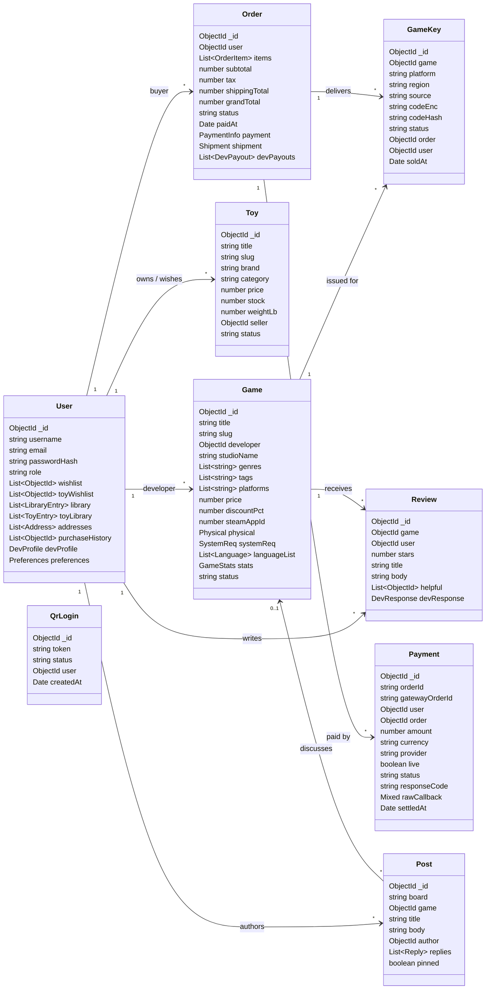

## 1.3 Mô tả các collection

### users
| Nhóm trường | Nội dung |
|---|---|
| Định danh | `username` (unique), `email` (unique), `passwordHash` (bcrypt, `select:false`) |
| Hồ sơ | `displayName`, `phone`, `avatar`, `bio`, `role` (`user`/`developer`/`admin`) |
| Thư viện | `library[]` (game, edition, purchasedAt, playMinutes, achievements), `toyLibrary[]` (toy, qty) |
| Mong muốn | `wishlist[]`, `toyWishlist[]` |
| Giao hàng | `addresses[]` (label, fullName, street, city, region, postal, country, phone) |
| Lịch sử | `playHistory[]`, `purchaseHistory[]` |
| Dev | `devProfile` (studioName, website, payoutEmail, verified, balanceOwed) |
| Tùy chọn | `preferences.favoriteGenres`, `preferences.matureFilter` |

### games
| Nhóm trường | Nội dung |
|---|---|
| Thông tin | `title`, `slug` (unique), `tagline`, `description`, `developer` (ref User), `studioName`, `publisher` |
| Phân loại | `genres[]`, `tags[]`, `platforms[]`, `features[]`/`categories[]`, `contentWarnings[]` |
| Giá | `price`, `discountPct` (0–90), `physical` (enabled, price, stock, weightLb, warehouse) |
| Steam | `steamAppId`, `digitalSku`, `systemReq` (minimum/recommended/lines/specs), `languages`, `languageList[]`, `deckVerified` |
| Media | `coverImage`, `screenshots[]` (URL `/api/media/<id>` từ GridFS) |
| Thống kê | `stats.views/unitsDigital/unitsPhysical/revenueGross/reviewSum/reviewCount/keysSold` |
| Trạng thái | `status` (`draft`/`pending`/`published`/`delisted`), `featured`, `releaseDate` |

### toys
`title`, `slug`, `brand`, `category` (Plush/Figure/Statue/Apparel/Book/Music/Pins/Other), `material`, `size`, `age`, `price`, `stock`, `weightLb`, `warehouse`, `includes[]`, `coverImage`, `screenshots[]`, `relatedAppId`, `status`, `seller` (ref User), `stats`.

### gamekeys
`game` (ref Game), `platform` (Steam/Epic/GOG/PixelVault), `region`, `source` (`supplier`/`demo`), `codeEnc` (AES-256-GCM `iv.tag.cipher`), `codeHash` (SHA-256, **unique**), `status` (`sold`/`revoked`), `order`, `user`, `soldAt`. Không có trạng thái "available": key chỉ sinh ra lúc đơn được fulfilment.

### orders
`user`, `items[]` (kind game/toy, game/toy ref, title, edition digital/physical, unitPrice, qty, weightLb, keyIds[]), `subtotal`, `tax`, `shippingTotal`, `grandTotal`, `status` (pending/paid/failed/fulfilled/shipped/delivered/cancelled), `paidAt`, `payment.method`, `shipment` (tracking, carrier, method, cost, address, status), `devPayouts[]`.

### payments
`orderId` + `gatewayOrderId` (unique), `user`, `order`, `amount` (VND), `currency`, `provider` (`vnpay`/`sandbox`), `live`, `status` (pending/success/failed), `responseCode`, `gatewayTransactionNo`, `rawCallback` (nguyên payload gateway), `settledAt`.

### posts
`board` (general/lfg/guides/support/deals/game), `game` (optional), `title`, `body`, `author` (ref User), `tags[]`, `pinned`, `locked`, `views`, `likes[]`, `replies[]` (user, text, likes, createdAt).

### reviews
`game` (ref Game), `user` (ref User), `stars` (1–5), `title`, `body`, `playMinutesAtReview`, `helpful[]`, `devResponse` (text, respondedAt). Unique index `(game, user)` — mỗi người chỉ đánh giá một lần.

### qrlogins
`token` (unique), `status` (pending/confirmed), `user`, `createdAt` (TTL 90 giây).

## 1.4 Dữ liệu trong database

| Collection | Số document | Vai trò |
|---|---:|---|
| `users` | 7 | 3 tài khoản demo (gamer / dev / mod) + 1 admin + 3 tài khoản test |
| `games` | 74 | Catalog game đồng bộ từ Steam Store API |
| `toys` | 12 | Merch vật lý (plush, figure, …) |
| `reviews` | 14 | Đánh giá của người dùng |
| `posts` | 1 | Bài cộng đồng |
| `orders` | 4 | 1 đơn `paid` + 3 đơn `cancelled` (thử thanh toán) |
| `gamekeys` | 1 | Key DEMO cấp khi đơn `paid` được fulfilment |
| `payments` | 4 | 1 `success` + 3 `pending` |
| `qrlogins` | 0 | Token QR dùng một lần, tự hết hạn |
| `sessions` | 25 | Phiên đăng nhập đang lưu trong MongoDB |
| `images.files` | 394 | Ảnh trong GridFS |
| `images.chunks` | 744 | Các chunk nhị phân của ảnh |

### Ví dụ document

**users — `vaultdweller`**
```json
{
  "_id": "6ac6e947b5813ede94f1c3a9",
  "username": "vaultdweller",
  "email": "gamer@vault.gg",
  "role": "user",
  "passwordHash": "<bcrypt hash>",
  "wishlist": [],
  "library": [],
  "addresses": [{ "label": "Home", "fullName": "Test User", "street": "1 Main St",
                  "city": "HCMC", "postal": "70000", "country": "US" }],
  "preferences": { "favoriteGenres": [], "matureFilter": false }
}
```

**games — `The Citadel`**
```json
{
  "_id": "6acc331b4fda3c326e2e2a4d",
  "title": "The Citadel",
  "slug": "the-citadel-mv4k02u4",
  "developer": "6ac6e947b5813ede94f1c3a8",
  "genres": ["Action", "Casual", "Indie"],
  "tags": ["FPS", "Retro", "Gore", "Old School", "Anime"],
  "price": 14.99,
  "discountPct": 0,
  "steamAppId": 1378290,
  "languages": 1,
  "languageList": [{ "name": "English", "audio": false }],
  "systemReq": {
    "specs": {
      "Windows": {
        "minimum": { "os": "Windows 10 64 bit", "cpu": "Intel Core i-5-10210U",
                     "ram": "8 GB RAM", "gpu": "NVIDIA GeForce 820M 1GB VRAM",
                     "api": "Version 12", "storage": "800 MB available space" },
        "recommended": { "os": "Windows 10 64 bit", "cpu": "Intel Core i-7-7700HQ CPU @2.80GHz",
                         "ram": "8 GB RAM", "gpu": "NVIDIA GeForce GTX 1060",
                         "api": "Version 12", "storage": "800 MB available space" }
      }
    }
  },
  "stats": { "views": 1, "reviewSum": 5, "reviewCount": 1, "keysSold": 0 },
  "status": "published"
}
```

**toys — `Hornet Plush`**
```json
{
  "_id": "6ac1ed742070ad547c6ce339",
  "title": "Hornet Plush",
  "slug": "hornet-plush-pv-toy-001",
  "brand": "Fangamer (official Hollow Knight)",
  "category": "Plush",
  "price": 32,
  "stock": 25,
  "status": "published"
}
```

**reviews**
```json
{
  "_id": "6acc37e4eb23280d3803d0ff",
  "game": "6acc331b4fda3c326e2e2a4d",
  "user": "6ac6e947b5813ede94f1c3a9",
  "stars": 5,
  "title": "Still the best in the genre",
  "body": "Played it for 200 hours and it has not lost a step…",
  "helpful": []
}
```

**images.files (GridFS)**
```json
{
  "_id": "6af47a6a21e30d1fcfe1067a",
  "filename": "https://cdn.cloudflare.steamstatic.com/steam/apps/105600/capsule_616x353.jpg",
  "contentType": "image/jpeg",
  "length": 107675,
  "uploadDate": "2026-11-11T14:23:39.729Z"
}
```

**orders — đơn đã thanh toán**
```json
{
  "_id": "6af4ba500d61444671a83445",
  "user": "6ac6e947b5813ede94f1c3a9",
  "status": "paid",
  "paidAt": "2026-11-11T18:56:16.699Z",
  "items": [{ "title": "Terraria", "edition": "digital", "qty": 1,
              "unitPrice": 9.99, "keyIds": ["6af4ba500d61444671a83450"] }],
  "subtotal": 9.99, "tax": 0.8, "shippingTotal": 0, "grandTotal": 10.79,
  "devPayouts": [{ "developer": "6ac6e947b5813ede94f1c3a8",
                   "gross": 9.99, "cut": 6.99 }]
}
```

**gamekeys — key đã cấp**
```json
{
  "_id": "6af4ba500d61444671a83450",
  "game": "6acc33194fda3c326e2e2a3f",
  "source": "demo",
  "codeEnc": "<AES-256-GCM payload>",
  "codeHash": "5f6bbb0c2637…",
  "status": "sold",
  "order": "6af4ba500d61444671a83445",
  "user": "6ac6e947b5813ede94f1c3a9",
  "soldAt": "2026-11-11T18:56:16.703Z"
}
```

**payments — giao dịch sandbox**
```json
{
  "_id": "6af4ba500d61444671a83447",
  "orderId": "PVMWCHCISS55CDC6",
  "gatewayOrderId": "PVMWCHCISS55CDC6",
  "amount": 269750,
  "currency": "VND",
  "provider": "sandbox",
  "live": false,
  "status": "success",
  "responseCode": "00",
  "settledAt": "2026-11-11T18:56:16.695Z"
}
```

## 1.5 Index chính

| Collection | Index | Mục đích |
|---|---|---|
| users | `username` (unique), `email` (unique) | đăng nhập / chống trùng |
| games | `slug` (unique), `title/tagline/description` (text), `price+discountPct`, `releaseDate`, `platforms`, `steamAppId` | tìm kiếm, lọc, sắp xếp |
| toys | `slug` (unique), text index, `price`, `category` | tìm kiếm merch |
| gamekeys | `codeHash` (unique), `game+status`, `user+createdAt` | chống cấp trùng key |
| orders | — | truy vấn theo `user` + `createdAt` |
| payments | `orderId` (unique), `gatewayOrderId` | chống settle hai lần |
| reviews | `game+user` (unique) | mỗi người 1 review/game |
| posts | `board` | lọc theo board |
| qrlogins | `token` (unique), TTL 90s | QR dùng một lần |
| sessions | TTL index | tự xoá phiên hết hạn |

## 1.6 Nguồn dữ liệu

- **Steam Store API**: tên, mô tả, thể loại, tags, giá, ngày phát hành, system requirements, ngôn ngữ, ảnh bìa.
- **Steam Web API**: số người đang chơi, đánh giá tổng hợp, tin tức.
- **VNPay sandbox**: callback thanh toán có chữ ký HMAC-SHA512.
- **Seed**: 3 tài khoản demo, 12 toy, 14 review, 1 bài forum.
- **Ảnh**: tải từ Steam CDN vào GridFS (394 file), phục vụ qua `/api/media/:id` — không hotlink.

---

# PHẦN 2 — CÁC CHỨC NĂNG

Mỗi mục gồm **Giao diện** (route + ảnh chụp) và **Luồng xử lý** (endpoint → dữ liệu → kết quả).

## 2.1 Đăng ký / đăng nhập

**Giao diện:** `/login`, `/register` — form email/mật khẩu, nút "Sign in with Google" (nếu cấu hình), nút "Scan to log in", link demo account.

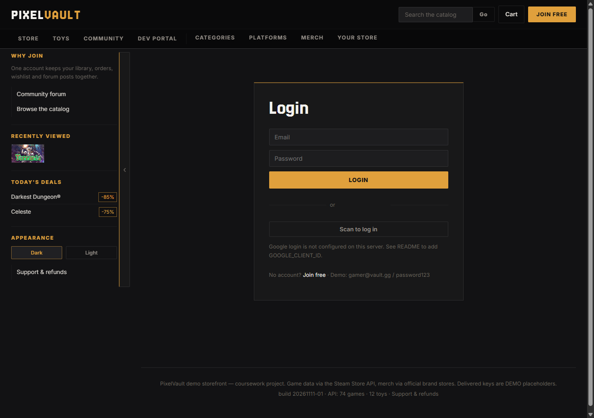

**Luồng xử lý:**
1. Người dùng gửi `POST /api/auth/register` hoặc `POST /api/auth/login`.
2. Server chuẩn hoá email, tìm `User` trong MongoDB.
3. Đăng ký: hash mật khẩu bằng **bcrypt** (10 rounds), tạo user với `role: 'user'`.
4. Đăng nhập: `bcrypt.compare`; sai 5 lần / 15 phút cho cùng IP+email thì bị chặn (`lib/loginLimiter.js`).
5. Thành công: ghi `req.session.user = { _id, username, role, email }`; session lưu trong MongoDB (`sessions`).
6. Client nhận `{ user }`, cập nhật state `me`, chuyển về trang trước.
7. Google: `POST /api/auth/google` nhận ID token, xác minh với `oauth2.googleapis.com/tokeninfo`, kiểm tra `aud`, tạo/tìm user rồi mở session.

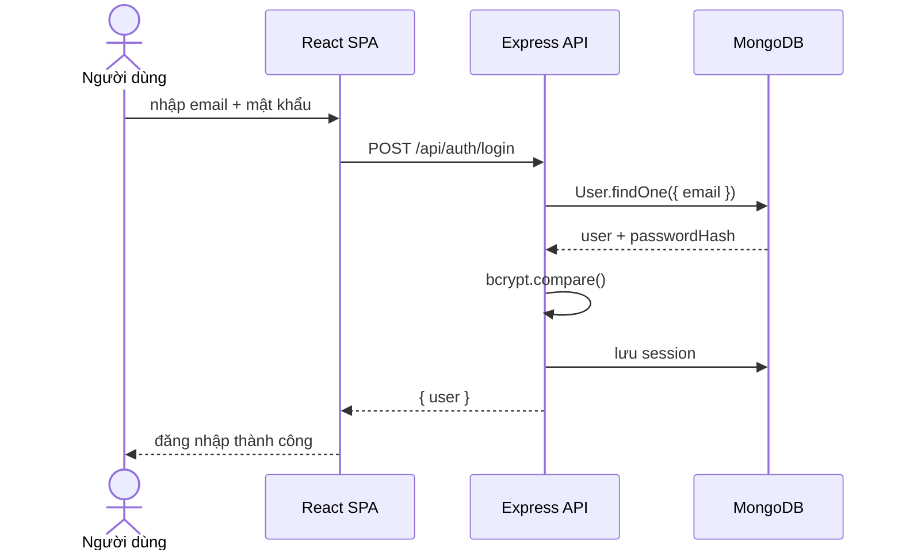

## 2.2 Đăng nhập bằng QR (web + Android)

**Giao diện:** nút "Scan to log in" trên trang login → hiện QR + trạng thái chờ; app Android quét mã bằng CameraX + ML Kit.

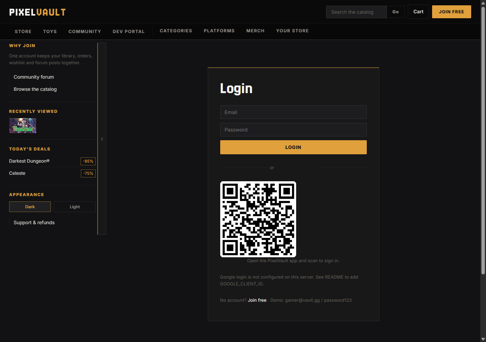

**Luồng xử lý:**
1. Web gọi `POST /api/qrlogin/request` → server tạo token ngẫu nhiên 24 byte, lưu `qrlogins` với `status: pending`, TTL 90 giây.
2. Web hiển thị token dưới dạng QR, poll `GET /api/qrlogin/status?token=...` mỗi 2 giây.
3. App Android (đã đăng nhập) quét QR, gọi `POST /api/qrlogin/confirm` kèm token và session cookie của app.
4. Server kiểm tra token còn hạn và đang `pending`, gán `user` của app, chuyển `status: confirmed`.
5. Web poll thấy `confirmed` → gọi `POST /api/qrlogin/activate`; server tạo session web cho đúng user đó, xoá token.
6. Token hết hạn sau 90 giây nên không thể phát lại.

## 2.3 Trang chủ

**Giao diện:** `/` — hero, ledger số liệu, featured, deals, hàng mới, toy shelf, forum strip.

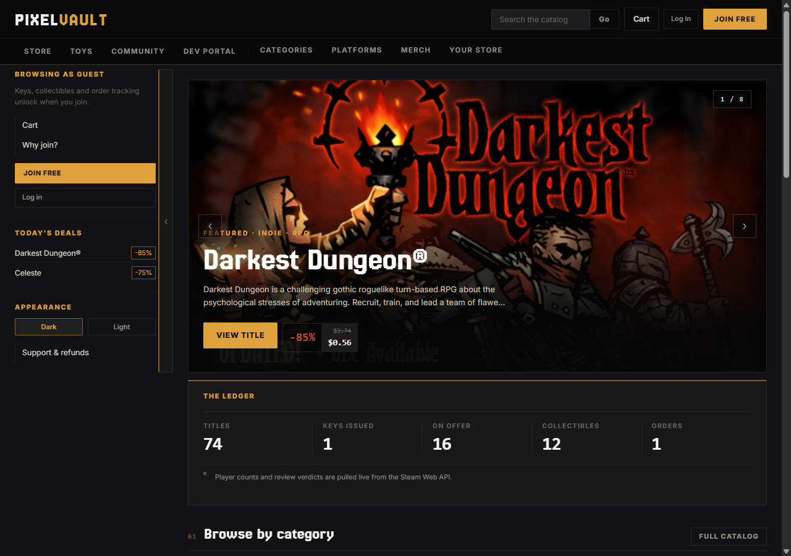

**Luồng xử lý:**
1. Client gọi `GET /api/home`.
2. Server chạy song song: `Game.find(featured)`, `Game.find(discountPct > 0).sort(discountPct -1)`, `Game.find().sort(releaseDate -1)`, `Toy.find()`, `Post.find()`, đếm `GameKey` đã bán / `Order`.
3. Trả `{ featured, deals, fresh, toys, catTiles, threads, ledger }`; cache TTL 30 giây (`lib/cache.js`).
4. Client render hero + ledger + các shelf.

## 2.4 Cửa hàng (store)

**Giao diện:** `/games` — lưới cover 16:9, sidebar filter (giá, genre, platform, feature), sort, phân trang.

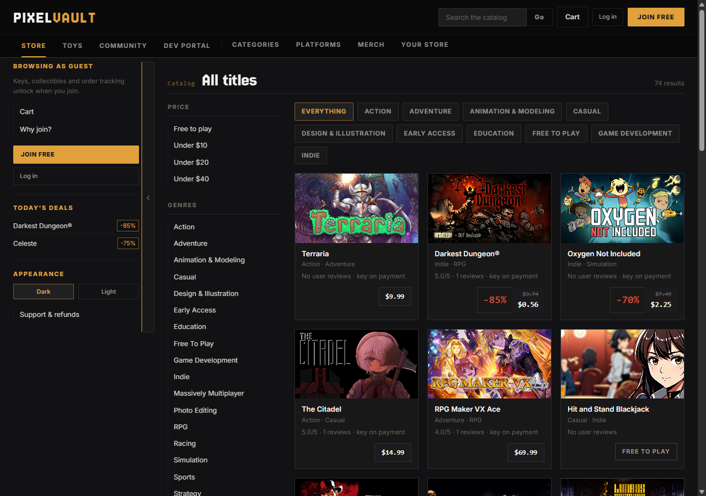

**Luồng xử lý:**
1. Client gọi `GET /api/games?q=&genre=&tag=&platform=&feature=&sort=&maxPrice=&onSale=&page=&limit=`.
2. Server lọc `status: published`, áp các điều kiện; nếu user bật "hide mature" thì loại rating M/AO.
3. Tìm theo từ khoá bằng regex trên title/description/tagline.
4. Sắp xếp theo popular / newest / priceAsc / priceDesc / rating.
5. Phân trang (`paginate`), trả kèm `genres`, `tags`, `categories`, `platforms` để dựng bộ lọc.
6. Client render lưới game + pager.

## 2.5 Chi tiết game

**Giao diện:** `/games/:slug` — gallery, mô tả, tag, system requirements (Minimum/Recommended), bảng ngôn ngữ, tin tức, review, "More like this", rail mua.

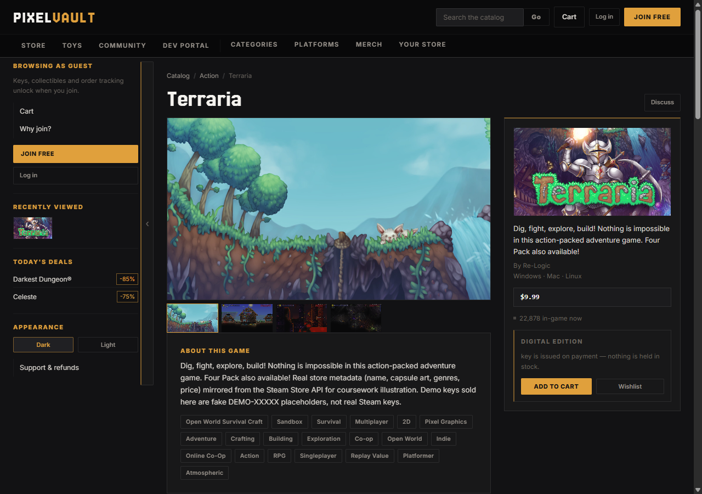
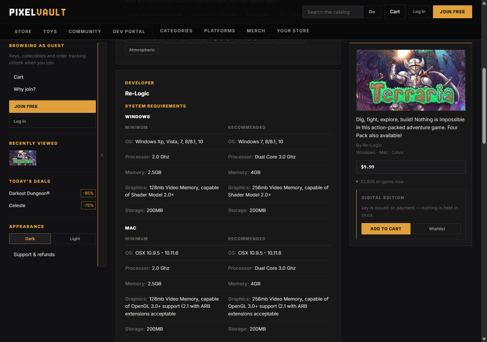
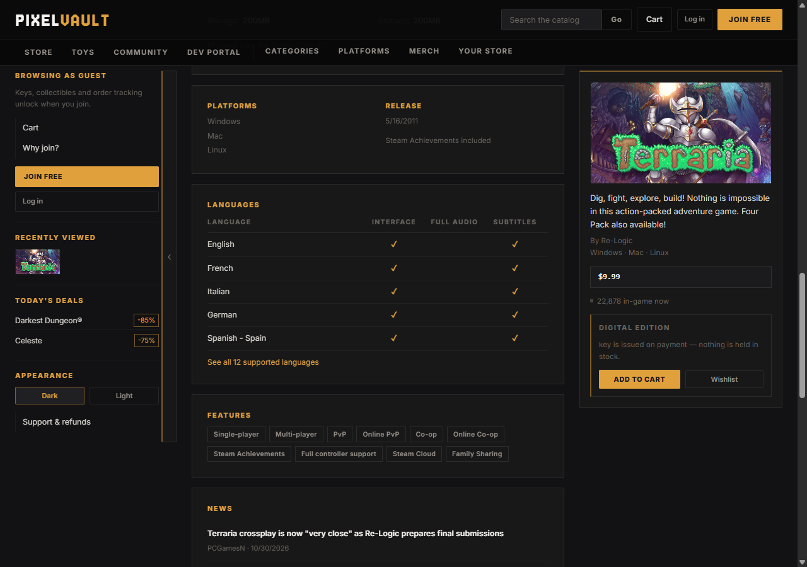

**Luồng xử lý:**
1. `GET /api/games/:slug` — tìm game, tăng `stats.views`, lấy review, thread liên quan.
2. `GET /api/live/:appid` và `GET /api/news/:appid` — số người chơi + tin tức từ Steam Web API (cache 10 phút).
3. Client render gallery, tag, bảng specs (`systemReq.specs`) và bảng ngôn ngữ (`languageList`).
4. "More like this": `GET /api/games?genre=<genre>&limit=5`, bỏ game hiện tại.
5. Người dùng thêm vào giỏ (`POST /api/cart/add`) hoặc wishlist (`POST /api/games/:id/wishlist`).
6. Mỗi lần xem, client lưu `{slug,title,coverImage}` vào `localStorage.pv:recent` để rail hiện "Recently viewed".

## 2.6 Merch / đồ chơi

**Giao diện:** `/toys` — danh sách merch, filter category/brand, sort; `/toys/:slug` — chi tiết.

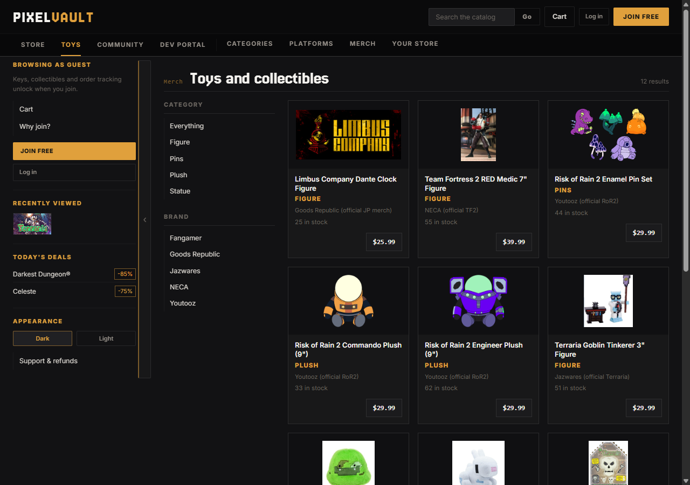

**Luồng xử lý:**
1. `GET /api/toys?q=&category=&brand=&sort=&page=` — lọc `status: published`, tìm kiếm, sắp xếp, phân trang.
2. `GET /api/toys/:slug` — chi tiết + game liên quan (`relatedAppId`).
3. Thêm vào giỏ với `kind: 'toy'`; tồn kho kiểm tra ở `POST /api/cart/add` và khi fulfilment.

## 2.7 Giỏ hàng

**Giao diện:** `/cart` — bảng item (ảnh, tên, edition, đơn giá, số lượng), nút +/- và xoá, subtotal, nút checkout.

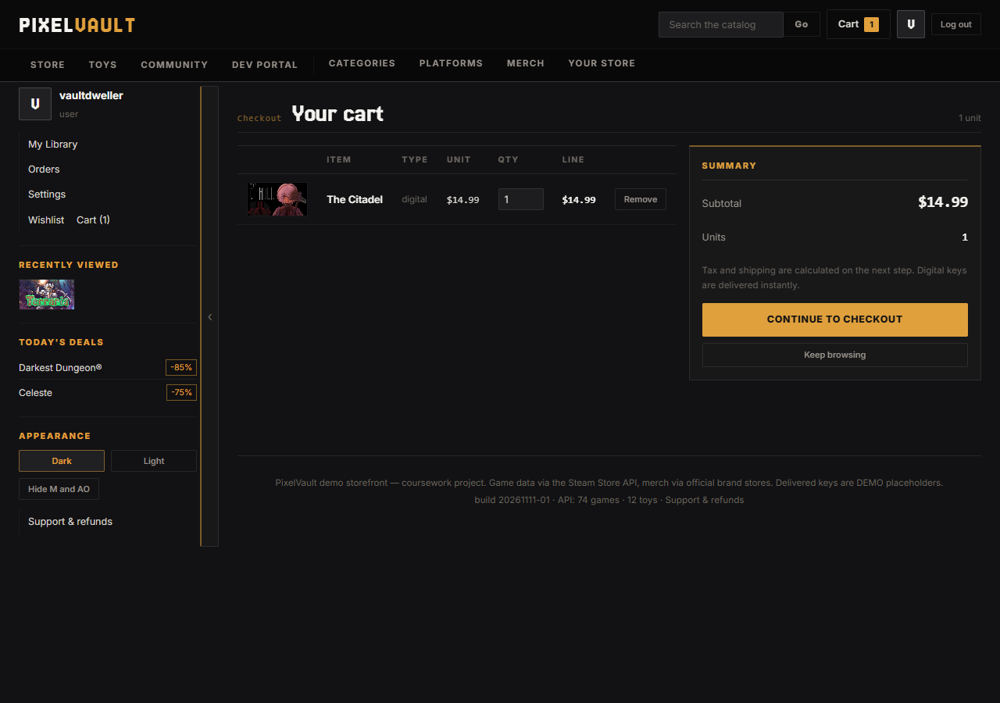

**Luồng xử lý:**
1. Giỏ lưu trong **session** (`req.session.cart`), không phải collection riêng.
2. `GET /api/cart` — làm mới title/ảnh/giá/tồn kho từ `Game`/`Toy`; xoá item nếu sản phẩm đã biến mất.
3. `POST /api/cart/add` — kiểm tra edition (digital/physical), tồn kho physical/toy; digital không có tồn kho vì key cấp khi thanh toán.
4. `POST /api/cart/qty` — tăng/giảm số lượng có kiểm tra tồn kho.
5. `POST /api/cart/remove` — xoá theo `key`.
6. Giỏ được giữ lại nếu thanh toán thất bại để người dùng thử lại.

## 2.8 Thanh toán

**Giao diện:** `/checkout` — nếu giỏ chỉ có digital: mục "Digital delivery" + "Payment"; nếu có physical/toy: thêm chọn shipping method + form địa chỉ. Tổng tiền gồm subtotal + tax + shipping.

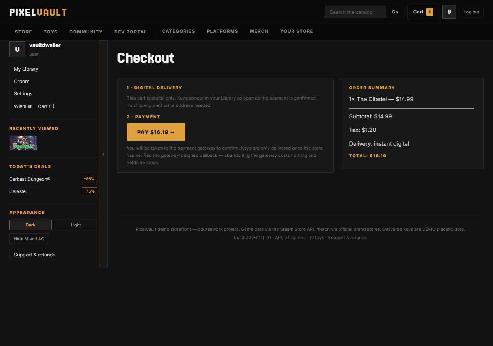

**Luồng xử lý:**
1. `GET /api/checkout/summary?method=` — tính lại subtotal, tax (`TAX_RATE`), shipping (chỉ khi có physical/toy), trả kèm địa chỉ đã lưu.
2. `POST /api/checkout/place`:
   - Kiểm tra đăng nhập, giỏ không rỗng, địa chỉ nếu có hàng vật lý.
   - Chặn mua trùng game đã sở hữu.
   - Kiểm tra tồn kho physical/toy bằng `findOneAndUpdate` có điều kiện (atomic).
   - Tạo `Order` trạng thái `pending`, snapshot giá/tên/edition.
   - Sinh `gatewayOrderId`, đổi USD → VND (`VND_PER_USD`), tạo URL VNPay có chữ ký HMAC-SHA512.
   - Tạo `Payment` trạng thái `pending`, trả `{ orderId, paymentUrl }`; client chuyển trình duyệt sang VNPay.
3. Người dùng thanh toán trên VNPay → VNPay gọi `GET /payment/return` (trình duyệt) và `GET /payment/ipn` (server-to-server).
4. `settleFromCallback`:
   - Xác minh chữ ký (`gateway.verifyCallback`), so khớp `vnp_Amount` với số tiền đã tạo.
   - `Payment.claim` chuyển `pending → success/failed` bằng một `findOneAndUpdate` — chỉ callback đầu tiên thắng, chống settle hai lần.
   - Nếu thất bại: order → `cancelled`.
   - Nếu thành công: gọi `fulfilOrder`.
5. `fulfilOrder`:
   - Claim order `pending → paid` (atomic).
   - Với từng item: toy/physical trừ kho có guard; digital gọi `issueKeys` (supplier hoặc DEMO), lưu `GameKey` (mã hoá AES-256-GCM + hash SHA-256 unique).
   - Cộng `stats`, credit 70% cho developer (`devProfile.balanceOwed`), thêm game/toy vào thư viện user, ghi `purchaseHistory`.
   - Nếu lỗi giữa chừng: revoke key đã cấp, hoàn kho, order → `failed`.
6. Chỉ khi thành công mới xoá giỏ; thất bại giữ giỏ để thử lại.

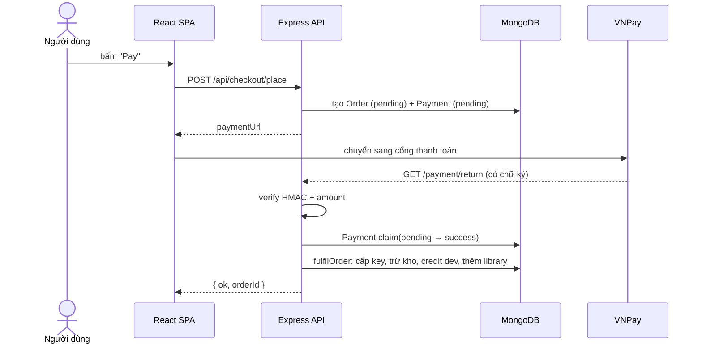

## 2.9 Giao key & bảo mật

**Giao diện:** key hiện trong `/library` và `/orders/:id`, có nút copy.

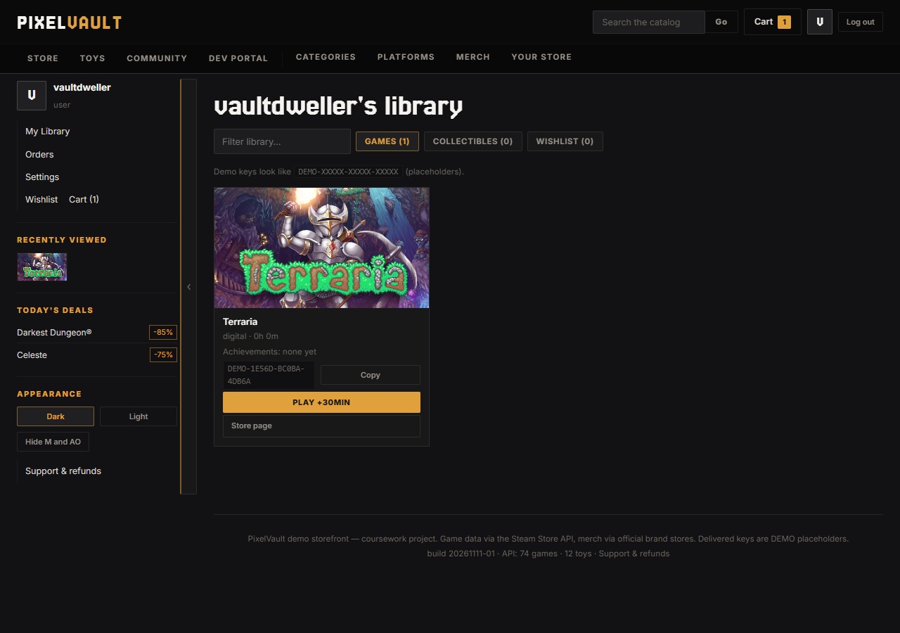

**Luồng xử lý:**
1. `lib/keyProvider.js` chọn nguồn: `KEY_SUPPLIER_URL` (POST `{game, edition, orderId}`, nhận `{key}`) hoặc DEMO placeholder.
2. Mỗi key được mã hoá **AES-256-GCM** (`iv.tag.cipher`) bằng `KEY_ENCRYPTION_SECRET`; hash **SHA-256** lưu `codeHash` unique.
3. `GameKey.issue` tạo document `status: sold`, gắn `order`, `user`, `soldAt`.
4. Chỉ chủ đơn/owner mới giải mã được key khi xem library/order.
5. Không có tồn kho key; không thể bán trùng vì `codeHash` unique.

## 2.10 Thư viện

**Giao diện:** `/library` — tab Games / Collectibles / Wishlist, playtime, achievements, key đã cấp.


**Luồng xử lý:**
1. `GET /api/library` — trả user (library, toyLibrary, wishlist), key theo game, key đã giải mã.
2. `POST /api/library/play/:gameId` — cộng 30 phút playtime, ghi `playHistory`.
3. Client render tab, nút copy key, tiến độ achievements.

## 2.11 Đơn hàng & giao vận

**Giao diện:** `/orders` — danh sách đơn + filter; `/orders/:id` — chi tiết item, key, shipment, nút huỷ đơn pending.

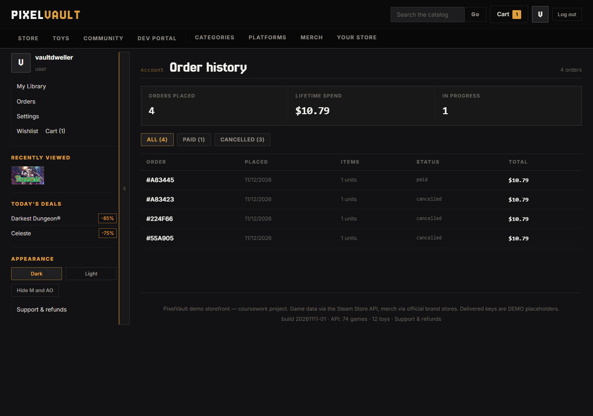

**Luồng xử lý:**
1. `GET /api/orders` — đơn của user, mới nhất trước.
2. `GET /api/orders/:id` — chi tiết + key đã giải mã (nếu là chủ đơn).
3. `POST /api/orders/:id/cancel` — chỉ huỷ được khi `status: pending`.
4. Admin: `POST /api/admin/orders/:id/advance` — packing → shipped → delivered (chỉ đơn có `shipment`).
5. Order digital không có shipment; UI hiện "Digital order — keys in library".

## 2.12 Wishlist

**Giao diện:** nút Wishlist trên game/toy detail; tab Wishlist trong `/library`; shortcut `Wishlist (n)` ở rail.

**Luồng xử lý:**
1. `POST /api/games/:id/wishlist` / `POST /api/toys/:id/wishlist` — toggle trong `User.wishlist` / `User.toyWishlist`.
2. Library trả cả hai danh sách; client hiển thị tab Wishlist.

## 2.13 Đánh giá

**Giao diện:** form review trong trang game (chọn sao, tiêu đề, nội dung); danh sách review + nút "Helpful"; Dev console có nút "Reply".

**Luồng xử lý:**
1. `POST /api/reviews/:gameId` — chỉ user đã sở hữu game mới review; unique `(game,user)`.
2. Server lưu `Review`, cập nhật `Game.stats.reviewSum/reviewCount`.
3. `POST /api/reviews/:id/helpful` — toggle user trong `helpful[]`.
4. `POST /api/reviews/:id/respond` — developer phản hồi, lưu `devResponse`.
5. Trang game hiển thị điểm trung bình + danh sách review.

## 2.14 Cộng đồng

**Giao diện:** `/community` — danh sách board/bài; `/community/p/:id` — chi tiết + reply; `/community/new` — tạo bài.

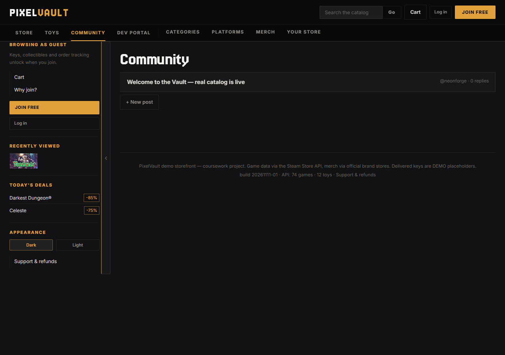

**Luồng xử lý:**
1. `GET /api/community?board=&game=` — danh sách bài (pinned trước).
2. `GET /api/community/p/:id` — chi tiết + replies.
3. `POST /api/community/new` — tạo bài (cần đăng nhập).
4. `POST /api/community/p/:id/reply` — thêm reply vào mảng nhúng.
5. Admin có thể xoá bài (`DELETE /api/admin/posts/:id`).

## 2.15 Dev Portal

**Giao diện:** `/dev` — KPI (gross, 70% cut, digital/physical units, owed), doanh thu theo tháng/khu vực, danh sách game, reply review; `/dev/new` publish game; `/dev/keys/:id` key vault; `/dev/toys` restock; `/dev/sales` báo cáo + CSV.

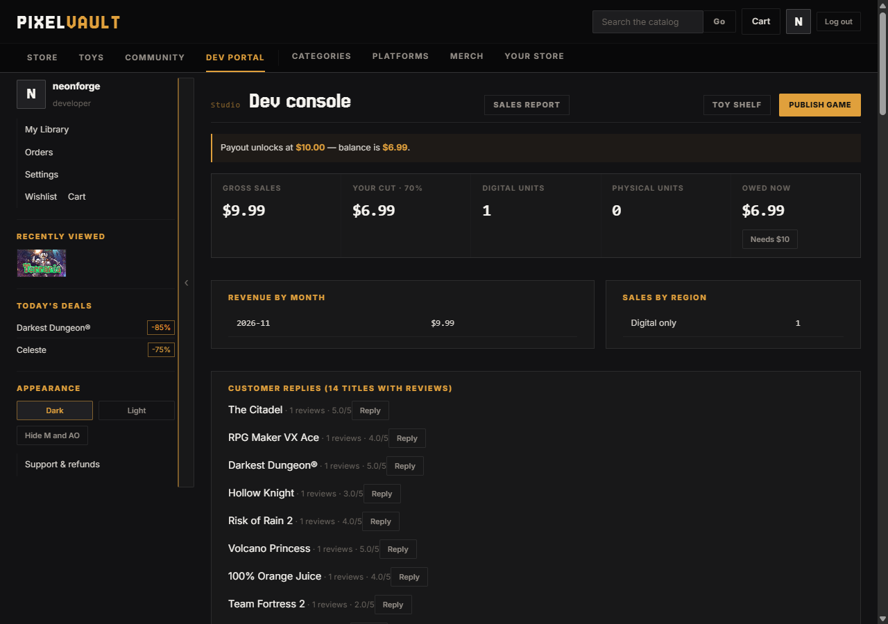
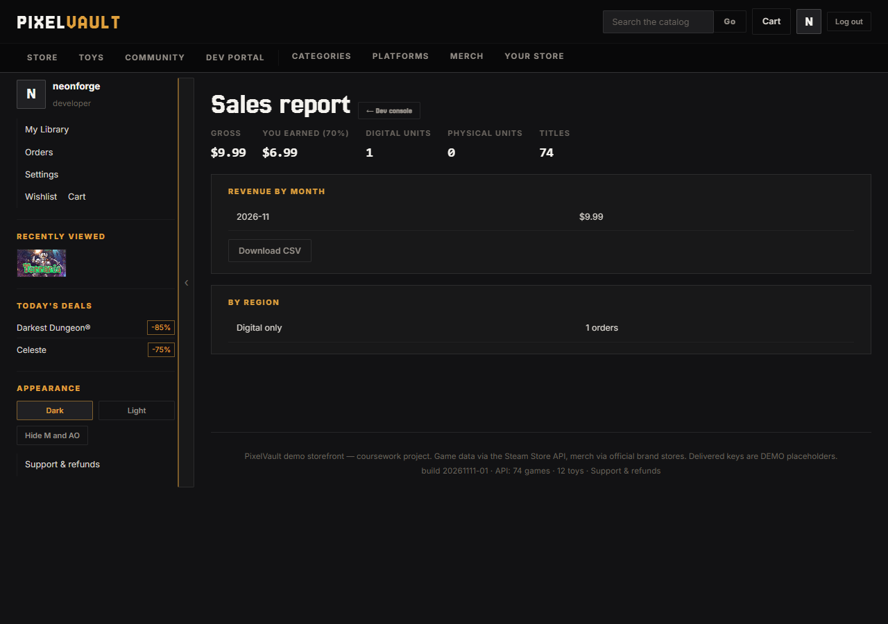

**Luồng xử lý:**
1. `POST /api/dev/apply` — nâng role `developer`, tạo `devProfile`.
2. `GET /api/dev` — tổng hợp từ `Order.devPayouts`, `Game.stats`, `Review`.
3. `POST /api/dev/new` — tạo game `pending`/`published` (tuỳ quyền).
4. `POST /api/dev/:id/edit` — sửa giá, discount, status, tồn kho physical.
5. `POST /api/dev/payout` — rút số dư (tối thiểu $10), reset `balanceOwed`.
6. `GET /api/dev/:id/keys` + `/keys/list` — thống kê key đã cấp; `POST /:id/keys/:keyId/revoke` thu hồi.
7. `GET /api/dev/sales` — doanh thu theo tháng + CSV.
8. `POST /api/dev/toys/:id/restock` — nhập thêm tồn kho toy.

## 2.16 Admin desk

**Giao diện:** `/admin` — KPI, tab Orders / Posts / Reviews; nút "Mark shipped"/"Mark delivered", xoá bài/review.

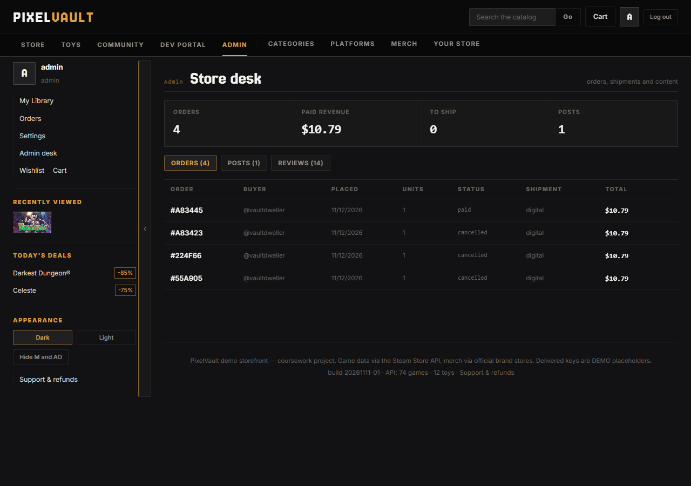

**Luồng xử lý:**
1. `GET /api/admin` — 100 đơn gần nhất, 60 bài, 60 review.
2. `POST /api/admin/orders/:id/advance` — chuyển trạng thái shipment, cập nhật order.
3. `DELETE /api/admin/posts/:id` / `DELETE /api/admin/reviews/:id` — xoá nội dung; xoá review cập nhật lại thống kê game.

## 2.17 Hồ sơ & cài đặt

**Giao diện:** `/users/:username` — hồ sơ công khai/thư viện preview; `/settings` — sửa displayName, bio, phone, favorite genres, mature filter, address book.

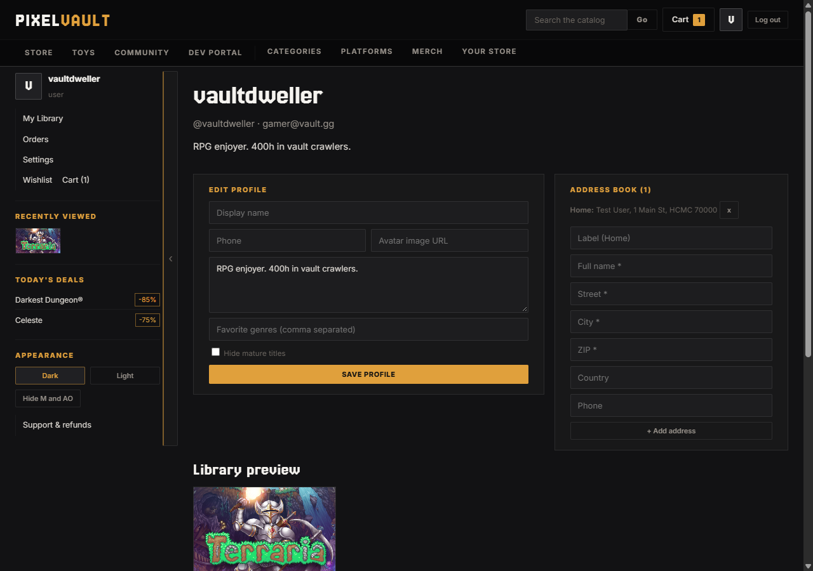
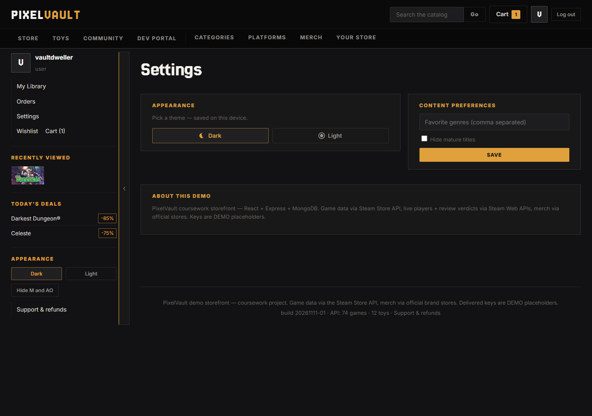

**Luồng xử lý:**
1. `GET /api/users/:username` — trả hồ sơ; nếu không phải chủ tài khoản thì ẩn email/phone/wallet/addresses.
2. `POST /api/users/me` — cập nhật các trường được phép.
3. `POST /api/users/me/addresses` / `DELETE /api/users/me/addresses/:id` — quản lý sổ địa chỉ.
4. `preferences.matureFilter` ảnh hưởng trực tiếp tới `GET /api/games`.

## 2.18 Media (GridFS)

**Giao diện:** ảnh trong mọi card/detail; URL dạng `/api/media/<fileId>`.

**Luồng xử lý:**
1. `seed/migrate-images-to-gridfs.js` tải ảnh từ Steam CDN, lưu vào bucket `images`.
2. Document game/toy lưu URL nội bộ `/api/media/<id>` thay vì hotlink.
3. `GET /api/media/:id` mở `GridFSBucket.openDownloadStream`, set `Content-Type` + cache `immutable`.
4. Ảnh không nằm trên filesystem; backup MongoDB là đủ.

## 2.19 App Android

**Giao diện:** app Kotlin/Jetpack Compose trong `Mobile/` — bottom nav Store / Community / Library / Account; login/register, store, game detail, cart, checkout (mở VNPay), orders, library, community, recommendations, profile, QR scanner.

**Luồng xử lý:**
1. Retrofit gọi cùng `/api/*`; session cookie được lưu bằng `PersistentCookieJar`.
2. Base URL mặc định `http://10.0.2.2:3000/api/` (emulator) hoặc LAN IP (máy thật).
3. QR scanner dùng CameraX + ML Kit, gọi `/api/qrlogin/confirm`.
4. Checkout mở `paymentUrl` bằng Intent sang trình duyệt.

## 2.20 Hỗ trợ

**Giao diện:** `/support` — chính sách giao key, refund, shipping.

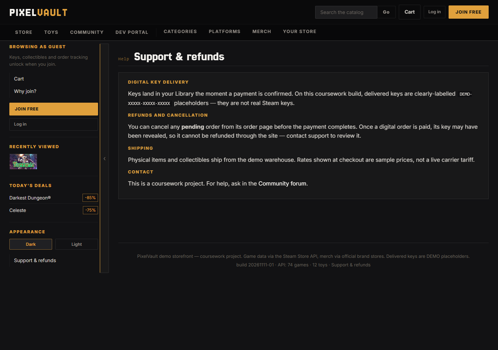

**Luồng xử lý:** trang tĩnh trong SPA, không gọi API.

---

## Phụ lục — Tài khoản demo

| Vai trò | Email | Mật khẩu |
|---|---|---|
| Người mua | `gamer@vault.gg` | `password123` |
| Developer | `dev@neonforge.gg` | `password123` |
| Admin | `admin@pixelvault.gg` | `password123` |
