# SỔ TAY SƠ ĐỒ — PIXELVAULT

Tài liệu tham chiếu 19 kiểu sơ đồ, khi nào dùng và cách vẽ. Các ví dụ Mermaid render trực tiếp trên GitHub; sơ đồ PlantUML cần PlantUML/mermaid.live để xuất ảnh.

## Bảng chọn nhanh

| # | Kiểu sơ đồ | Trả lời câu hỏi | Công cụ |
|---|---|---|---|
| 1 | Flowchart | Luồng xử lý / thuật toán | Mermaid |
| 2 | DFD (context + level 1) | Dữ liệu đi từ đâu đến đâu | Mermaid flowchart |
| 3 | Swimlane | Ai làm bước nào | Mermaid subgraph |
| 4 | Use case | Ai dùng được chức năng gì | PlantUML |
| 5 | Sequence | Các thành phần gọi nhau theo thứ tự nào | Mermaid |
| 6 | Class | Mô hình dữ liệu / đối tượng | Mermaid |
| 7 | ERD | Bảng, khoá, quan hệ | Mermaid |
| 8 | State | Vòng đời trạng thái | Mermaid |
| 9 | Activity | Luồng nghiệp vụ có nhánh song song | Mermaid flowchart |
| 10 | User journey | Trải nghiệm người dùng qua từng bước | Mermaid journey |
| 11 | Mind map | Phân rã ý tưởng / module | Mermaid mindmap |
| 12 | Gantt | Tiến độ theo thời gian | Mermaid gantt |
| 13 | Timeline | Mốc lịch sử / roadmap | Mermaid timeline |
| 14 | Kanban | Việc đang ở cột nào | Mermaid kanban (v11+) |
| 15 | Git graph | Nhánh và merge | Mermaid gitGraph |
| 16 | Quadrant | Ưu tiên theo 2 trục | Mermaid quadrantChart |
| 17 | Sankey | Dòng chảy / tỉ lệ chuyển đổi | Mermaid sankey-beta |
| 18 | Pie / XY chart | Tỉ lệ / xu hướng | Mermaid pie, xychart-beta |
| 19 | Block / Architecture | Kiến trúc thành phần | Mermaid block-beta / architecture-beta |
| 20 | WBS | Phân rã công việc | PlantUML |
| 21 | Heatmap / Funnel / Venn / Wireframe | Mật độ, phễu, giao thoa, giao diện | draw.io, Figma, Excel |

---

## 1. Flowchart — luồng xử lý

**Dùng khi:** mô tả thuật toán, luồng if/else, luồng đăng nhập.
**Thành phần:** start/end (oval), process (rect), decision (diamond), arrow.
**Mẹo:** 5–7 node; mỗi nhánh ghi điều kiện rõ; tránh đường cắt nhau.

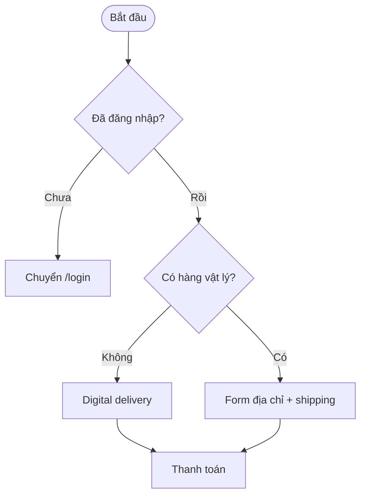

## 2. DFD — Data Flow Diagram

**Dùng khi:** mô tả dữ liệu vào/ra hệ thống, không quan tâm thứ tự thời gian.
**Thành phần:** external entity (hình vuông), process (tròn), data store (2 gạch ngang), data flow (mũi tên có nhãn).

**Level 0 (context):**
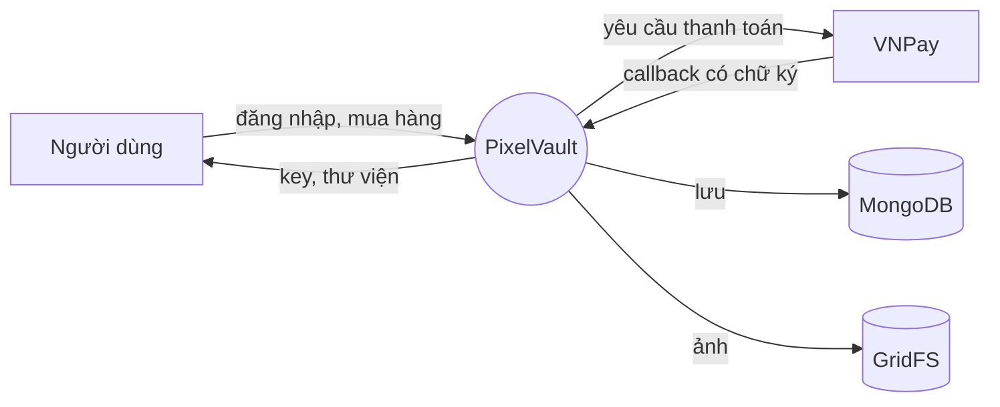

**Level 1 (phân rã):**
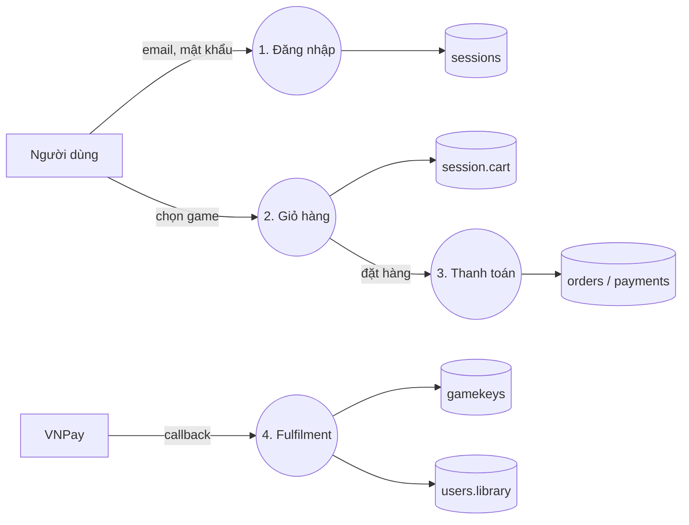

## 3. Swimlane — sơ đồ bơi

**Dùng khi:** nhiều vai trò cùng tham gia một quy trình.
**Mẹo:** mỗi làn = một vai trò; thứ tự làn trái → phải; mũi tên nét đứt cho handoff.

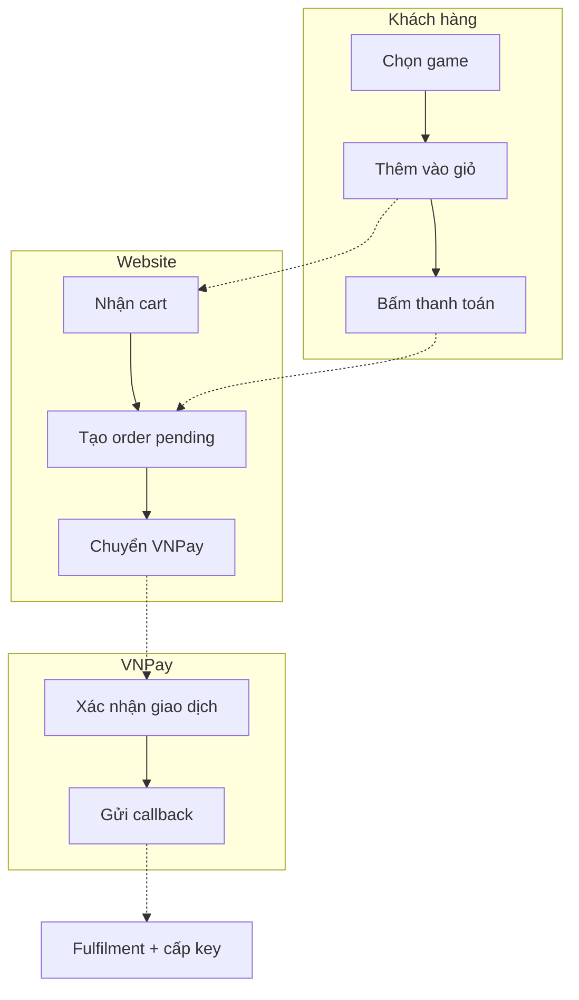

## 4. Use case — chức năng theo vai trò

**Dùng khi:** liệt kê chức năng tổng quan cho báo cáo.
**Thành phần:** actor (người), use case (oval), `include`/`extend`.
**Mẹo:** đừng biến use case thành flowchart; mỗi oval là một mục tiêu người dùng.

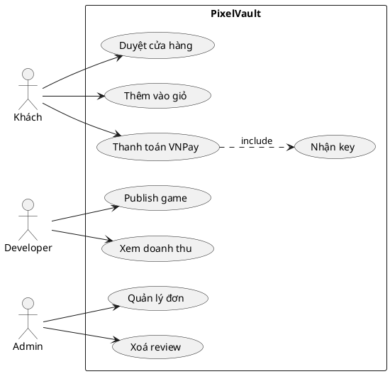

## 5. Sequence — thứ tự gọi

**Dùng khi:** mô tả một luồng qua nhiều thành phần (đăng nhập, thanh toán, QR).
**Thành phần:** actor/participant, message (→), return (-->>), `alt`/`opt`/`loop`.
**Mẹo:** chỉ giữ 4–6 participant; đặt tên theo tầng (SPA → API → DB → Gateway).

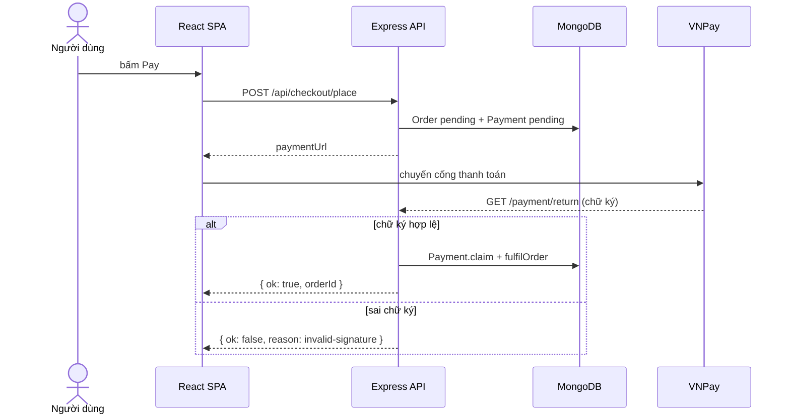

## 6. Class — mô hình dữ liệu

**Dùng khi:** trình bày schema/đối tượng và quan hệ.
**Mẹo:** chỉ ghi field quan trọng; ghi cardinality; tách enum ra ghi chú.

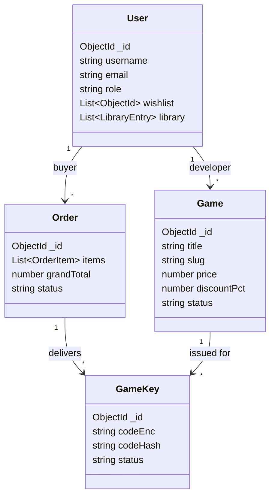

## 7. ERD — quan hệ bảng

**Dùng khi:** cần nhấn mạnh khoá và quan hệ 1–N / N–N (gần với MongoDB hơn class diagram).
**Mẹo:** ghi rõ PK/FK; không cần method.

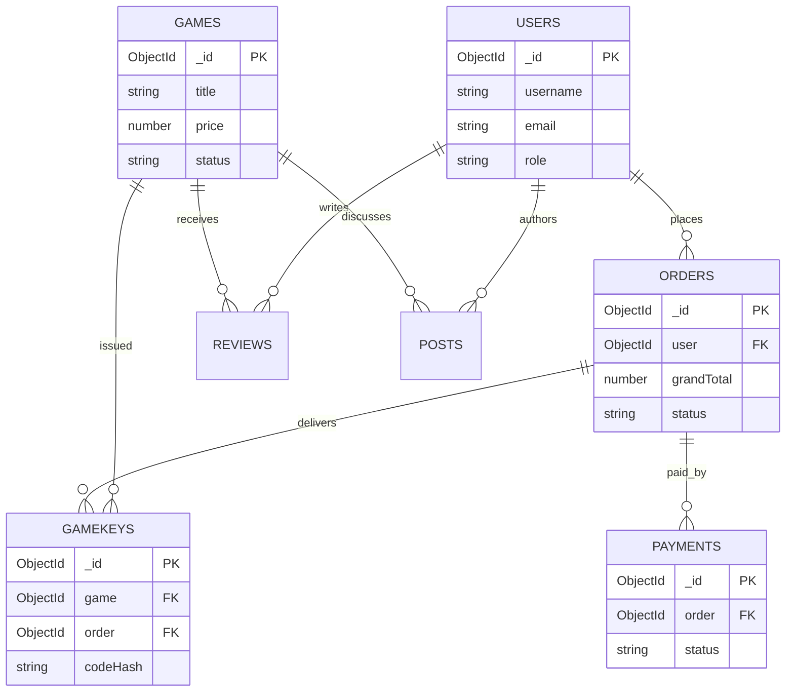

## 8. State — vòng đời trạng thái

**Dùng khi:** một thực thể có nhiều trạng thái và chuyển trạng thái có điều kiện (order, payment, shipment).
**Mẹo:** mỗi mũi tên ghi sự kiện; đánh dấu trạng thái cuối.

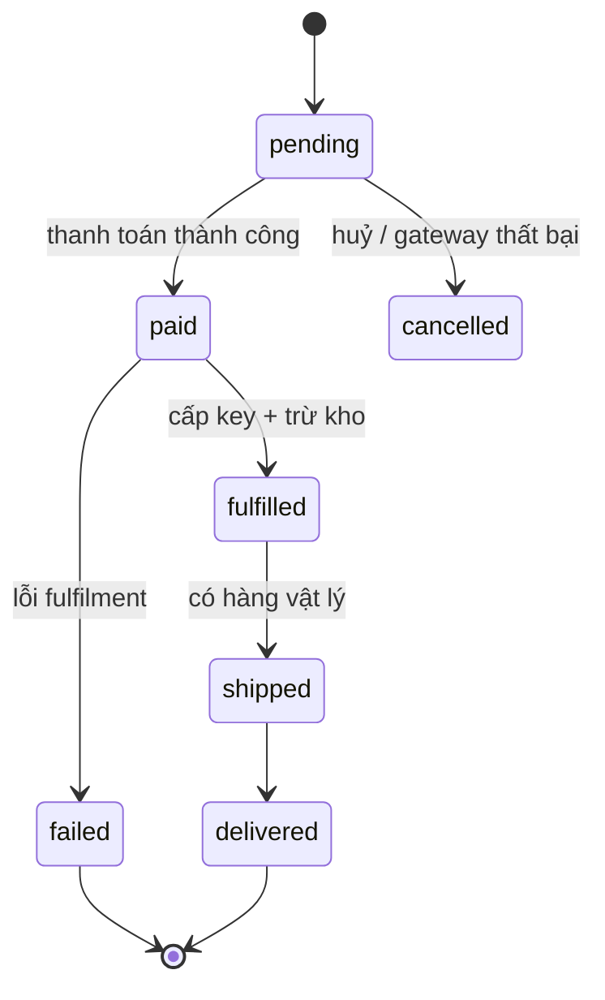

## 9. Activity — luồng nghiệp vụ

**Dùng khi:** quy trình có nhánh song song / nhiều bước nghiệp vụ (gần flowchart nhưng có fork/join).
**Mẹo:** dùng `fork/join` cho bước song song; ghi rõ điều kiện ở decision.

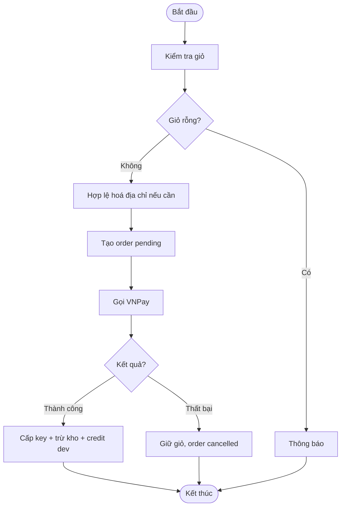

## 10. User journey — trải nghiệm người dùng

**Dùng khi:** trình bày UX, điểm đau, mức hài lòng từng bước.
**Thang điểm:** 1 (tệ) → 5 (tốt).

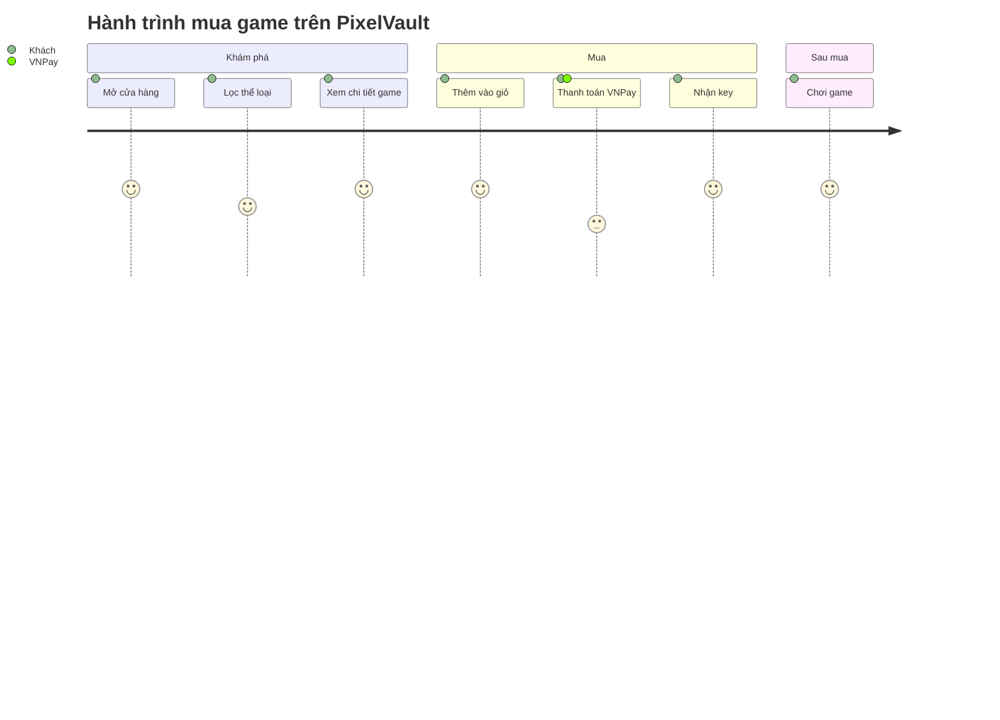

## 11. Mind map — phân rã ý tưởng

**Dùng khi:** brainstorm, chia module, mục lục báo cáo.
**Mẹo:** tối đa 3 tầng; mỗi nhánh 3–5 node.

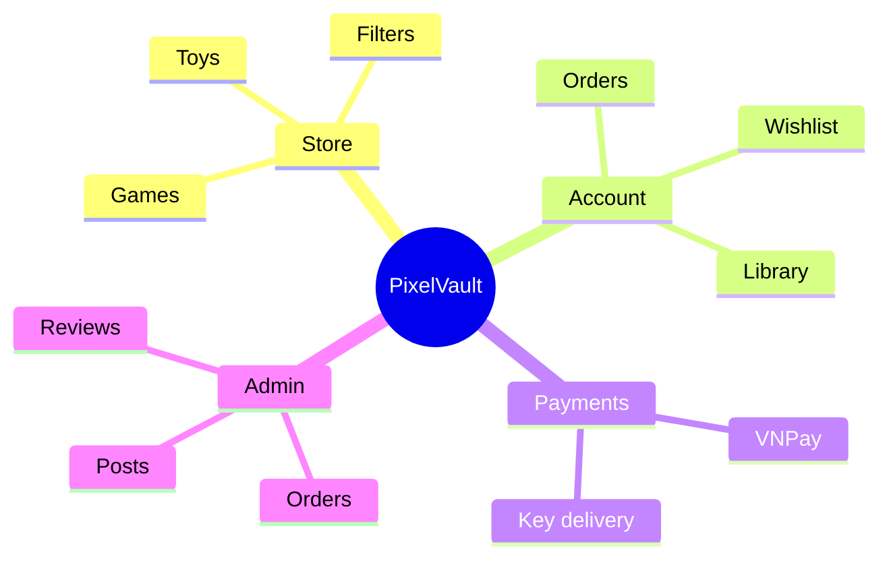

## 12. Gantt — tiến độ

**Dùng khi:** kế hoạch đồ án, sprint, roadmap.
**Mẹo:** chia section theo giai đoạn; dùng `after` để nối task.

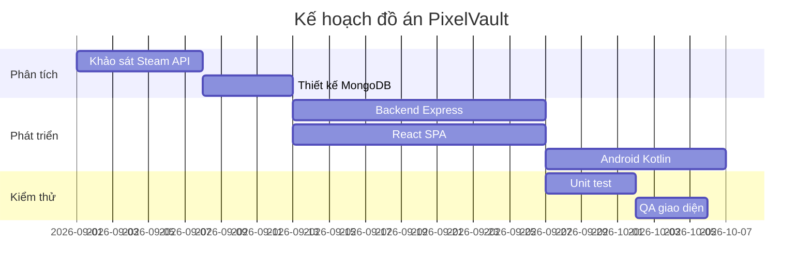

## 13. Timeline — mốc lịch sử

**Dùng khi:** lịch sử phát triển, các cột mốc.
**Mẹo:** mỗi mốc 1 dòng; không quá 8 mốc.

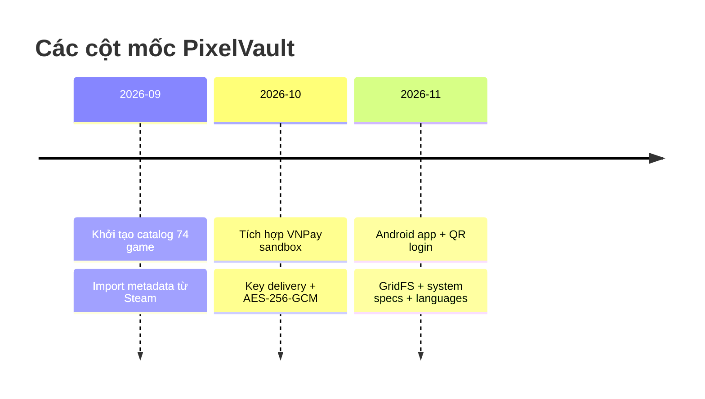

## 14. Kanban — trạng thái công việc

**Dùng khi:** quản lý việc nhóm, demo quy trình.
**Lưu ý:** Mermaid kanban cần v11+; nếu GitHub chưa render, dùng flowchart 3 cột.

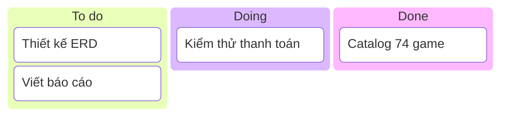

## 15. Git graph — nhánh và merge

**Dùng khi:** minh hoạ quy trình git, feature branch.
**Mẹo:** chỉ vẽ nhánh chính + 2–3 nhánh feature.

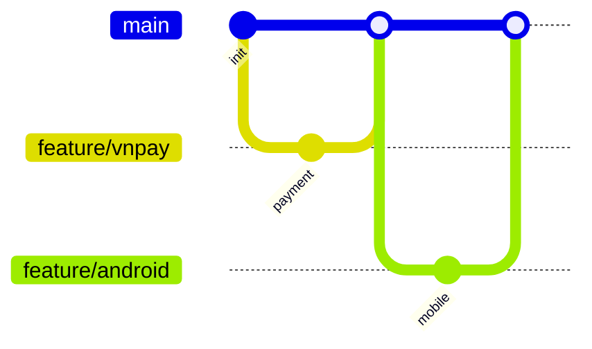

## 16. Quadrant — ưu tiên 2 trục

**Dùng khi:** chọn tính năng theo giá trị / công sức, rủi ro / tác động.
**Mẹo:** đặt tên 4 góc theo hành động (Làm ngay, Lên kế hoạch, Bỏ qua, Làm sau).

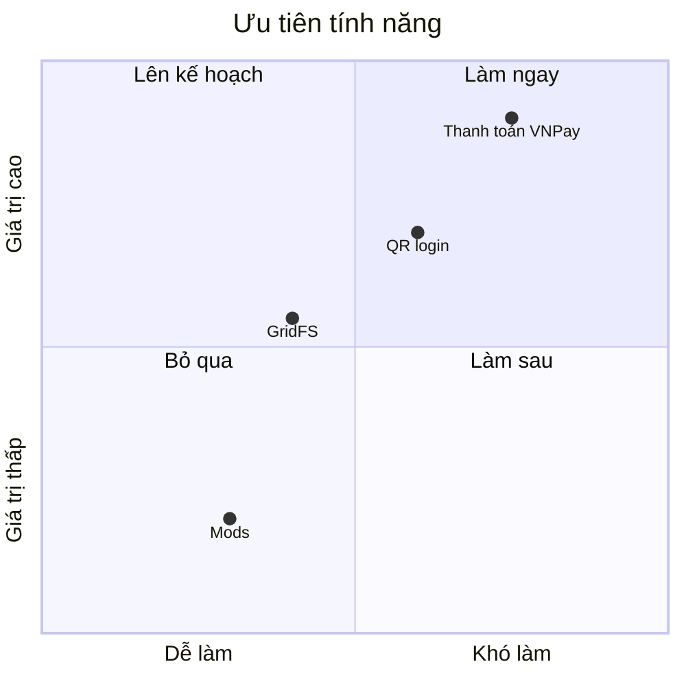

## 17. Sankey — dòng chảy / phễu

**Dùng khi:** tỉ lệ chuyển đổi, phân bổ nguồn lực, dòng người dùng.
**Mẹo:** tổng hai đầu phải khớp; nhãn ngắn.

```mermaid
sankey-beta
"Người dùng","Giỏ hàng",100
"Giỏ hàng","Thanh toán",60
"Giỏ hàng","Bỏ đi",40
"Thanh toán","Đơn thành công",45
"Thanh toán","Thất bại",15
```

## 18. Pie / XY chart — tỉ lệ và xu hướng

**Pie:** tỉ lệ một thời điểm (tối đa 5–6 lát).
**XY:** xu hướng theo thời gian; kết hợp bar + line.

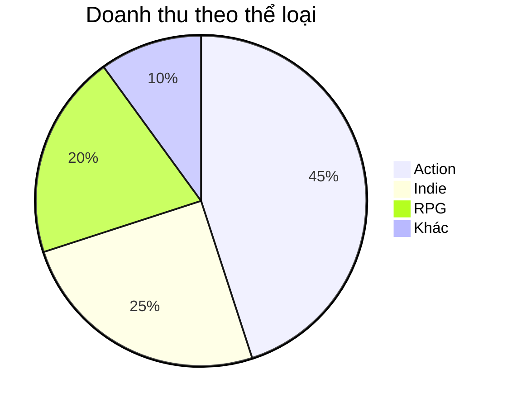

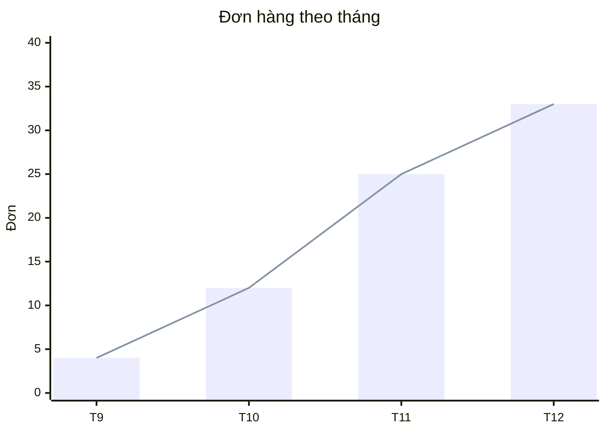

## 19. Block / Architecture — kiến trúc thành phần

**Block:** các khối lớn, ít chi tiết.
**Architecture-beta:** cần Mermaid v11+; nếu không render, dùng flowchart.

```mermaid
block-beta
  columns 3
  spa["React SPA"] api["Express API"] db[("MongoDB")]
  grid["GridFS"] vnpay["VNPay"] key["Key supplier"]
```

```mermaid
flowchart LR
  SPA[React SPA] --> API[Express API]
  MOB[Android App] --> API
  API --> DB[(MongoDB)]
  API --> GF[(GridFS)]
  API --> VNP[VNPay]
  API --> SUP[Key supplier]
```

## 20. WBS — phân rã công việc

**Dùng khi:** chia việc theo cây (báo cáo, đồ án).
**Công cụ:** PlantUML.

```plantuml
@startwbs
* PixelVault
** Phân tích
*** Khảo sát Steam API
*** Thiết kế MongoDB
** Phát triển
*** Backend Express
*** React SPA
*** Android Kotlin
** Kiểm thử
*** Unit test
*** QA giao diện
@enduml
```

## 21. Heatmap / Funnel / Venn / Wireframe

Không có native Mermaid; dùng công cụ khác:

| Kiểu | Dùng khi | Cách vẽ nhanh |
|---|---|---|
| Heatmap | Mật độ lỗi, hoạt động theo giờ | Bảng Excel/Google Sheets + conditional formatting |
| Funnel | Tỉ lệ rơi rụng qua từng bước | draw.io / Figma; hoặc Sankey |
| Venn | Giao thoa 2–3 tập | draw.io / Figma |
| Wireframe | Phác giao diện trước khi code | Figma / Excalidraw / draw.io |

---

## Mẹo chung khi đưa sơ đồ vào slide

1. **Một sơ đồ = một ý.** Đừng nhồi cả hệ thống vào một hình.
2. **5–7 node** là giới hạn đọc tốt trên slide; chi tiết để sơ đồ phụ.
3. **Một accent color** cho điểm nhấn; còn lại dùng đen/trắng/xám.
4. **Label ngắn**, động từ + danh từ: "Tạo order", "Cấp key", "Gửi callback".
5. **Sequence:** actor bên trái, thời gian chảy xuống; đánh số bước nếu thuyết trình.
6. **Class/ERD:** chỉ giữ field quan trọng; ghi cardinality; tách bảng lớn thành 2 sơ đồ.
7. **Xuất ảnh cho PowerPoint:** mermaid.live → Export PNG/SVG; hoặc `npx @mermaid-js/mermaid-cli -i file.mmd -o out.png -w 1920`.
8. **Kiểm tra render** trên GitHub trước khi chụp vào slide.

Sources:
- [Mermaid — All Diagram Examples](https://mermaid.ai/open-source/syntax/all-examples.html)
- [Mermaid Studio — Diagram Types](https://mermaidstudio.dev/docs/diagram-types/overview/)
- [Mermaid Cheatsheet — All 19 Diagram Types](https://mermandraw.com/cheatsheet/)
- [UML Diagram Types — Creately](https://creately.com/blog/diagrams/uml-diagram-types-examples/)
- [DFD Levels 0, 1, 2 — Flowova](https://flowova.ai/blog/data-flow-diagram-guide)
- [PlantUML Diagram Types](https://deepwiki.com/plantuml/plantuml/4-diagram-types)
